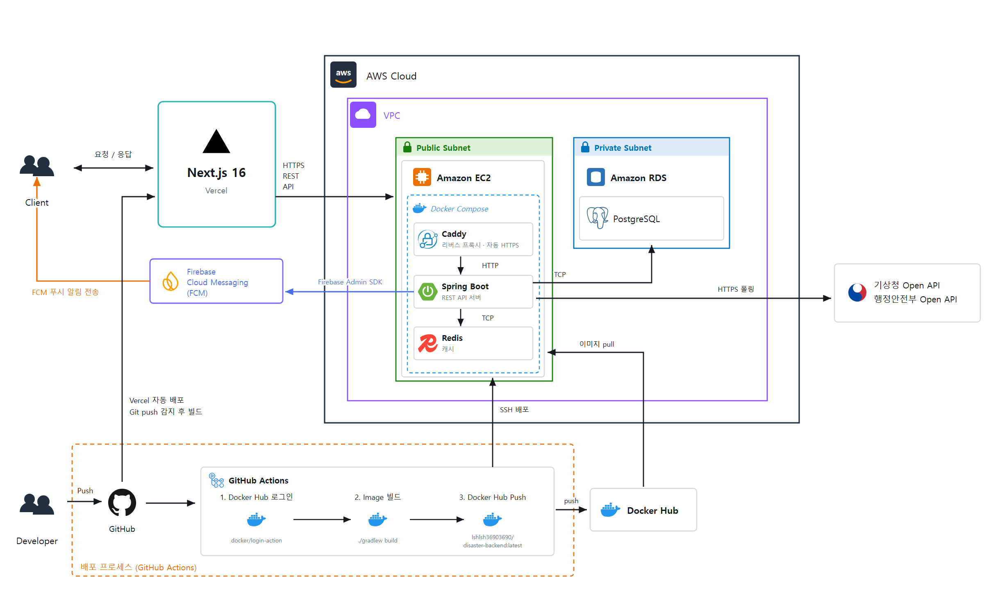
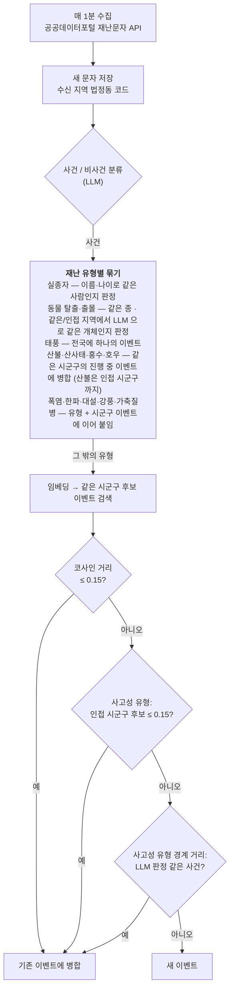
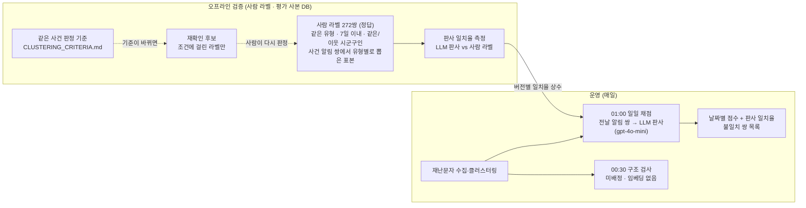

# Disaster Alert Archive

> 재난 안전 문자 아카이브 및 사용자 맞춤형 실시간 알림 서비스

[](https://nextjs.org/)
[](https://spring.io/projects/spring-boot)
[](https://www.postgresql.org/)
[](https://redis.io/)
[](https://www.docker.com/)

**🔗 배포 URL: [https://disaster-alert-archive.co.kr/](https://disaster-alert-archive.co.kr/)**

## 소개

행정안전부 공공 API로 수집한 재난 안전 문자를 아카이빙하고, 사용자가 설정한 관심 지역에 실시간 푸시 알림을 보내는 서비스입니다.
AI 기반 이벤트 클러스터링으로 같은 사건의 알림을 하나로 묶고, 기상 데이터와 연계한 재난 통계를 제공합니다.

## 주요 기능

| 기능 | 설명 |
|------|------|
| 재난 문자 아카이빙 | 행안부 Open API 수집·저장, 검색/필터 |
| 맞춤 푸시 알림 | 관심 지역 설정 → FCM 푸시 (모바일, 게스트 포함) |
| 이벤트 클러스터링 | 임베딩 + LLM 판정으로 같은 사건의 알림을 하나의 이벤트로 병합 |
| 실종자 알림 병합 | 동일 인물 판정으로 지역을 넘어 하나의 이벤트로 병합 |
| 재난 통계·지도 | 지역별·유형별·기간별 통계, 기상 연계, 시도→읍면동 드릴다운 지도 |
| 다국어 | 재난 문자·이벤트 제목 번역 (KO → EN/JA/ZH) |
| 커뮤니티 | 재난 제보, 게시판, 댓글, 소셜 로그인(Google·Naver·Kakao) |
| 공개 OpenAPI | 토큰 기반 재난 문자 API (JSON/CSV) |

## 기술 스택

| 영역 | 기술 |
|------|------|
| Frontend | Next.js 16 (App Router), TanStack Query, Zustand, TailwindCSS 4, i18next, PWA + Firebase |
| Backend | Spring Boot 3.4, JPA + QueryDSL, Spring Security + JWT, Flyway, Spring AI (OpenAI) |
| Data | PostgreSQL 16 + pgvector, Redis 7 |
| 외부 API | 행안부 재난문자, 기상청, OpenAI, Firebase Cloud Messaging, OAuth |
| Infra | 셀프호스팅 Docker Compose, Cloudflare Tunnel, GitHub Actions (self-hosted 러너) |

## 시스템 아키텍처



### 재난문자 수집·클러스터링 파이프라인



같은 사건인지 가르는 기준은 [`CLUSTERING_CRITERIA.md`](specs/001-event-clustering-pipeline/CLUSTERING_CRITERIA.md), 경로별 상세 동작은 [`specs/001-event-clustering-pipeline/`](specs/001-event-clustering-pipeline/)에 있습니다.

### 클러스터링 검증 파이프라인

사람 라벨(정답)로 LLM 판사를 검증하고, 검증된 판사가 운영 클러스터링을 매일 채점합니다.



- 사람 라벨만 정답으로 씁니다. LLM 판사는 사람 라벨과의 일치율(현재 같은 사건 90.1% · 다른 사건 91.4%)을 잰 뒤에만 채점에 쓰고, 점수 옆에 그 일치율을 함께 남깁니다.
- 판사의 프롬프트나 모델을 바꾸면 272쌍으로 일치율을 다시 잽니다. 상세는 [`specs/006-clustering-evaluation/`](specs/006-clustering-evaluation/)에 있습니다.

## 프로젝트 구조

```
disaster-alert-archive/
├── backend/        # Spring Boot REST API (/api/v1/*) — domain/* 도메인별 controller→service→repository
├── frontend/       # Next.js (App Router)
├── specs/          # 서브시스템별 명세 (spec.md / plan.md)
└── docs/           # PRD·TRD·API/데이터 모델 문서, 시스템 구성도
```

## 로컬 실행

사전 요구사항: Java 17+, Node.js 20+, Docker

```bash
# Postgres(pgvector) + Redis
docker compose -f docker-compose.dev.yml up postgres redis

# 백엔드 (http://localhost:8080, Swagger: /swagger-ui.html)
cp .env.example .env.dev          # 값 채우기
cd backend && ./gradlew bootRun

# 프론트엔드 (http://localhost:3000)
cd frontend && npm install
cp .env.local.example .env.local  # 값 채우기
npm run dev
```

환경 변수 전체 목록은 `.env.example`(백엔드)과 `frontend/.env.local.example`에 있습니다. FCM 서비스 계정 키만은 환경 변수가 아니라 `backend/src/main/resources/firebase-service-account.json` 파일로 읽습니다.
외부 API 키 없이 개발하는 방법은 [CONTRIBUTING.md](CONTRIBUTING.md#외부-api-키가-없을-때)를 참고하세요.

## 테스트

```bash
cd backend  && ./gradlew test   # 실제 OpenAI 를 부르는 @Tag("realApi") 는 제외
cd frontend && npm test
```

DB에 붙는 통합 테스트(`@IntegrationTest`)는 위 docker Postgres 가 떠 있어야 합니다.

## 기여하기 (PR 가이드)

PR 은 언제든 환영합니다. 한국어·영어 모두 괜찮습니다.

1. **이슈를 먼저 열어 주세요.** [버그 제보 / 기능 제안](https://github.com/lshlsh3690/disaster-alert-archive/issues/new/choose)으로 무엇을 왜 바꾸려는지 적고, 메인테이너의 답을 받은 뒤 작업을 시작합니다. 오타 수정은 이슈 없이 바로 PR 을 보내도 됩니다.
2. 저장소를 fork 하고 **`develop` 에서** 브랜치를 만듭니다 (`main` 은 쓰지 않습니다). 예: `fix/123-guest-push`
3. 로직을 바꿨다면 테스트를 함께 추가하고 `./gradlew test` / `npm test` 가 통과하는지 확인합니다.
4. 커밋 메시지는 `type(scope): 설명` 형식입니다. 예: `fix(notification): 시도 전체 관심 지역 게스트에게 푸시가 안 가던 문제를 고친다`
5. **base 를 `develop` 으로** PR 을 열고 본문에 `Closes #이슈번호` 를 적습니다. CodeRabbit 자동 리뷰 후 메인테이너가 머지합니다.

키·`.env*` 파일은 절대 커밋하지 마세요. 보안 취약점은 공개 이슈 대신 **Security → Report a vulnerability** 로 비공개 제보해 주세요.
코드 컨벤션, 키 없이 개발하는 방법, 클러스터링 변경 시 필요한 근거 등 자세한 내용은 [CONTRIBUTING.md](CONTRIBUTING.md)에 있습니다.

## 문서

| 문서 | 내용 |
|------|------|
| [`specs/`](specs/) | 서브시스템별 명세 — 이벤트 클러스터링(001), FCM 알림(003), 법정동 매칭(004), 번역(005), 클러스터링 평가(006) |
| [`docs/`](docs/) | PRD·TRD·API 명세·데이터 모델 |
| [`CONTRIBUTING.md`](CONTRIBUTING.md) | 기여 가이드 |
| [`CLAUDE.md`](CLAUDE.md) | 아키텍처 요약·팀 컨벤션·알려진 함정 |

## 라이선스

[MIT](LICENSE)
