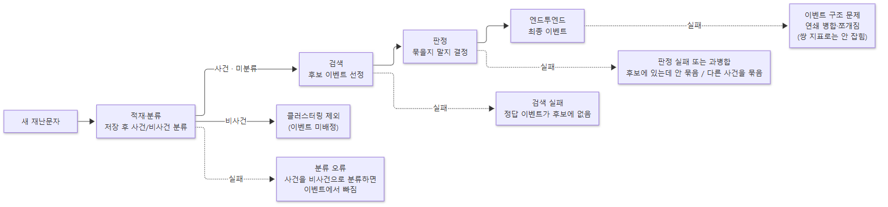
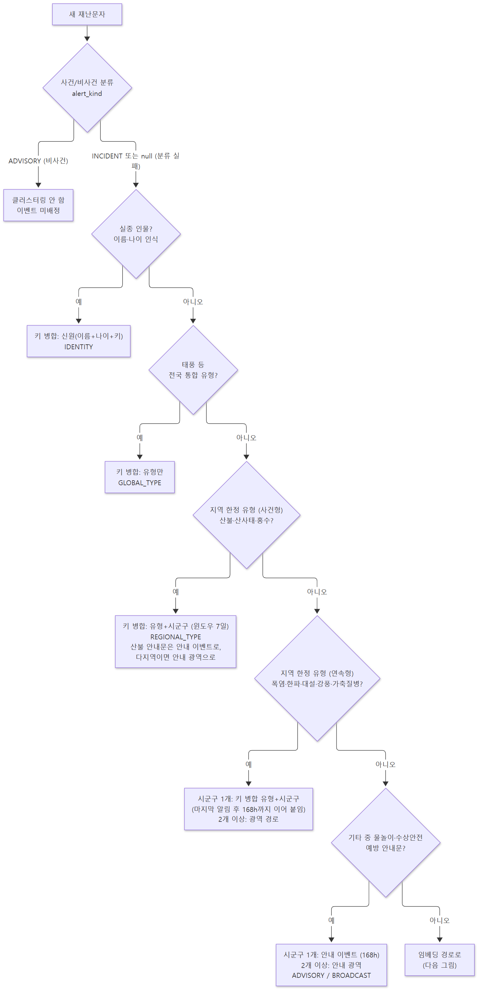
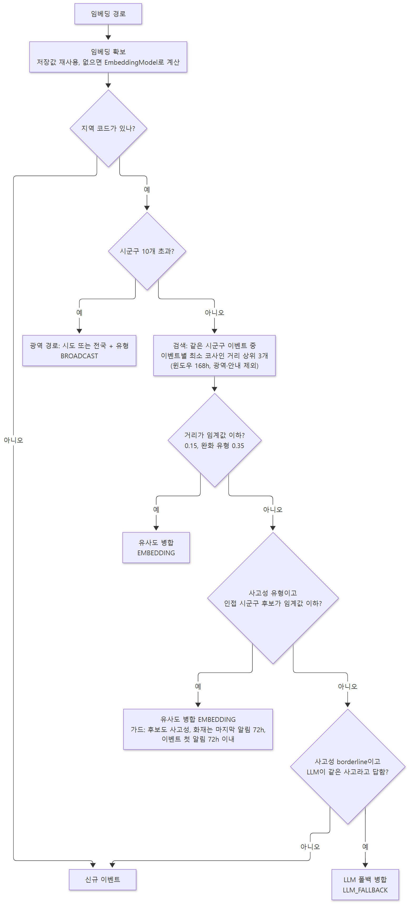
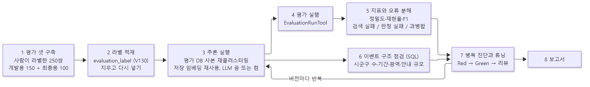

# 이벤트 클러스터링 구현·검증 파이프라인 — RAG 평가 단계와의 대응

이벤트 클러스터링은 RAG가 아니지만, RAG 평가처럼 검색 → 판정(생성에 대응) → 엔드투엔드로 쪼개 보면 오류 원인을 단계별로 분리할 수 있다. 이 문서는 (1) 단계 대응, (2) 구현 파이프라인, (3) 검증 파이프라인, (4) 단계별 지표, (5) 평가 데이터, (6) 실측 사례, (7) 남은 과제를 기록한다. 마지막으로 갱신한 시점은 품질 개선 PR #292~#298이 모두 머지된 뒤다.

> 한 줄 요약: 사람이 직접 라벨한 **총 250쌍**(개발용 150 + 최종용 100)으로 측정해, 개발용 재현율 0.615 → 0.844(+22.9%p), 정밀도 1.000 유지, 전체 이벤트 9,697 → 5,388로 줄였다. 자세한 비교는 `docs/CLUSTERING_QUALITY_REPORT.md`.

> 평가 도구는 2026-10-19 에 두 비율(과소병합율·과병합율) 도구로 새로 작성했다. 현재 도구의 읽는 법은 [CLUSTERING_EVAL_GUIDE.md](CLUSTERING_EVAL_GUIDE.md) 를 본다. 이 문서의 검색/판정 단계 서술과 8절 이후 실측 수치는 옛 도구로 잰 값이다.

---

## 1. 단계 대응

| RAG 단계 | 클러스터링에서의 의미 | 입력 → 출력 |
|---|---|---|
| 적재·분류 (RAG 앞단) | 수집한 문자를 저장하고 **사건/비사건으로 분류**해 클러스터링 대상을 거른다(4.0절) | 새 문자 → 사건·미분류는 통과, 비사건은 제외 |
| 검색 (Retrieval) | 새 재난문자와 **연관된 문자/이벤트를 후보로 선정** | 새 문자 → 후보 이벤트 (최대 3개) |
| 생성 (Generation) | 후보와 **묶을지 말지를 결정**. 묶으면 병합, 아니면 신규 이벤트 | 새 문자 + 후보 → 병합 / 신규 |
| 엔드투엔드 | 최종 결과로 **여러 재난문자가 묶인 이벤트**가 나오는 것 | 문자 스트림 → 이벤트 집합 |



### 검토 의견: 이 대응은 맞고, 네 가지를 보정해서 기록한다

1. **검색을 건너뛰는 경로가 있다.** 인물(실종), 태풍, 지역 한정 유형(산불·산사태·홍수), 에피소드형(폭염·한파·대설·강풍·가축질병), 안내성(`기타` 물놀이)은 후보를 검색하지 않고 "유형+시군구" 같은 **키**로 곧바로 이벤트를 정한다(키 병합). 이 경로에서는 검색과 판정이 하나로 합쳐져 있어서 검색 실패/판정 실패로 나누어 볼 수 없다. 단계별 분해는 **임베딩 경로(그 외 유형)에서만** 의미가 있다.
2. **"생성 단계"는 텍스트 생성이 아니라 이진 판정이다.** 출력이 병합/신규 둘 중 하나이고 대부분 결정적 규칙(거리 임계값, 가드)이다. 생성 모델에 해당하는 것은 사고성 유형의 borderline 건에서 호출하는 LLM 폴백뿐이다.
3. **클러스터링 앞에 적재·분류 단계가 있다.** RAG 의 "문서 수집·전처리"에 해당하며, 비사건(ADVISORY)은 여기서 걸러져 검색·판정에 들어가지 않는다. 분류가 사건을 비사건으로 잘못 거르면 그 알림은 이벤트에서 빠지고, 평가에서는 "이벤트 미배정" 쌍으로 제외된다.
4. **엔드투엔드는 쌍 지표만으로 충분하지 않다.** 쌍 단위 정밀도·재현율은 최종 이벤트를 쌍으로 풀어서 본 대리 지표다. 이벤트의 모양(여러 시군구·긴 기간에 걸쳐 이어 붙은 것, 한 사건이 여러 이벤트로 쪼개진 것)은 쌍 라벨에 없으면 보이지 않는다(6절 사례).

---

## 2. 구현 파이프라인 (새 재난문자 1건이 들어올 때)

수집 직후 사건/비사건 분류(4.0절)를 통과한 알림만 `EventClusteringService.doCluster`가 위에서부터 판단하고, 앞 단계에서 처리되면 뒤 단계는 건너뛴다. 아래 두 그림은 한 흐름을 둘로 나눈 것이다.

**① 키 병합 경로** — 본문을 보지 않고 키가 같으면 병합하는 분기(위에서부터 판단, 앞에서 처리되면 건너뜀)



**② 임베딩 경로** — 위 분기에 걸리지 않은 알림이 도달하는 기본 경로(유사도 병합)



이 그림에는 실종자·탈출 동물을 다루는 cross-region 보조 패스(`EventCrossRegionService`)를 넣지 않았다(별도 패스).

### 병합 방식은 두 종류다
| 방식 | 판단 기준 | 경로 (`MergeMethod`) |
|---|---|---|
| **유사도 병합** | 본문 임베딩의 코사인 거리 (+ 필요하면 LLM) | `EMBEDDING`, `LLM_FALLBACK` |
| **키 병합** | 본문이 아니라 **키가 같은지** | 유형+시군구(지역 한정 유형, 에피소드형), 인물 신원(`IDENTITY`), 태풍(`GLOBAL_TYPE`), 시도·전국 광역(`BROADCAST`), 안내(`ADVISORY`) |

- **클러스터링**은 알림을 이벤트로 묶는 전체 과정이고, **병합**은 알림 하나를 기존 이벤트에 넣는 한 동작이며, 병합 방식이 위 두 종류다.
- **지역 한정 유형**은 키 병합 중 "유형+시군구"를 키로 쓰는 유형이다. 사건형(산불·산사태·홍수: 윈도우 안이면 합침)과 연속형(폭염·한파·대설·강풍·가축질병: 마지막 알림 후 168h 끊김 전까지 안내와 특보까지 계속 이어 붙임)으로 나뉜다.
- 같은 두 알림이라도 방식에 따라 결과가 다르다. "산청 산불 대피 안내"와 "산청 산불 진화 현황"은 본문이 달라 유사도 병합이면 거리가 0.15를 넘어 갈라지고, 키 병합이면 같은 시군구+산불이라 합쳐진다.

---

## 3. 검증 파이프라인



| 단계 | 내용 | 도구·산출물 |
|---|---|---|
| 1 평가 셋 구축 | 개발용 150쌍(일반 60% / 경계 20% / 함정 20%), 최종용 100쌍(정밀도 40 / 재현율 40 / 어려운 부정 20). 같음·다름·모르겠음, 판정 기준 4가지 | `backend/evaluation/datasets/`, 라벨링 HTML 페이지 |
| 2 라벨 읽기 | 라벨 CSV 를 DB 적재 없이 바로 읽는다(형식 오류는 줄 번호와 함께 즉시 실패) | `LabelCsv` |
| 3 추론 실행 | 평가 DB 사본을 만들어 이벤트 테이블을 비우고 **재클러스터링** | `EventClusteringBackfillTool` (`--backfill.recluster=true`) |
| 4 평가 실행 | 각 쌍의 두 알림이 같은 이벤트에 들어 있는지 DB 에 저장된 배정에서 읽는다 | `EvaluationRunTool`(profile `eval`), `AssignmentReader` |
| 5 지표·틀린 쌍 | 과소병합율·과병합율 두 비율과, 놓친 쌍·잘못 묶은 쌍의 사실 4개(유형·같은 시군구·간격·본문 거리). 원인은 추정하지 않는다 | `PairCounter`, `ReportFormatter`(마크다운). 읽는 법은 `CLUSTERING_EVAL_GUIDE.md` |
| 6 이벤트 구조 점검 | 쌍 라벨로 안 잡히는 문제를 SQL로 직접 확인 | 수동 SQL (자동화 안 됨) |
| 7 병목 진단·튜닝 | 오류 원인을 보고 개선 → Red-Green → 단위 테스트 → 코드 리뷰 → 재클러스터링 → 재측정 | 버전별 DB 클론 비교 |
| 8 보고서 | V0 대비 단계별 개선량과 한계 | `docs/CLUSTERING_QUALITY_REPORT.md` |

판정 기준(rubric)은 `backend/evaluation/datasets/cluster-eval-2026-10.rubric.md`에 있다. 같은 에피소드와 되풀이 안내는 같은 사건, 별개의 사고와 서로 다른 지역에서 병렬로 안내되는 같은 기상 상황은 다른 사건으로 본다.

---

## 4. 단계별 구현과 지표

### 4.0 적재·분류 단계
- **구현**: `DisasterFetchScheduler`가 공공데이터 응답을 파싱해 새 알림을 저장(`alertService.saveData`)한 뒤, 알림마다 번역 → FCM 트리거 → **사건/비사건 분류**(`AlertKindService.classifyAndSave`, LLM few-shot) → 이벤트 클러스터링 → cross-region 순으로 이어서 실행한다. 분류 결과는 `disaster_alert.alert_kind`(`INCIDENT`·`ADVISORY`)에 저장한다.
- **클러스터링과의 관계**: `ADVISORY`(비사건)는 이벤트를 만들지도 기존 이벤트에 들어가지도 않는다. `INCIDENT`와 분류 실패(`null`)는 클러스터링한다(기준은 `CLUSTERING_CRITERIA.md` 2절). 분류가 실패해도 예외를 삼켜 수집·클러스터링을 막지 않는다.
- **지표**: 평가 도구는 이 단계를 따로 재지 않는다. 다만 비사건 알림은 이벤트에 배정되지 않으므로, 그 알림이 든 라벨 쌍은 평가에서 **"이벤트 미배정"으로 제외**되고 건수만 리포트에 적힌다(`CLUSTERING_EVAL_GUIDE.md`). 분류 자체의 정확도는 이 도구의 범위 밖이다.

### 4.1 검색 단계
- **구현**: `DisasterEventRepository.findTopCandidates` — 같은 시군구(앞 5자리) footprint 교집합, 마지막 알림이 윈도우(168h) 안, 광역·안내 이벤트 제외, 이벤트별 최소 코사인 거리 오름차순 상위 3개. 사고성 유형은 `findTopAdjacentCandidates`로 `region_adjacency` 이웃 시군구의 이벤트도 추가 조회한다(조회 윈도우 48h, 후보 이벤트 첫 알림 72h 이내 등 가드 포함).
- **지표**: 평가 도구는 검색 단계를 따로 재지 않는다. 놓친 쌍이 검색 단계 탓인지 판정 단계 탓인지는 계산하지 않고, 필요할 때 별도로 조사한다(2026-10-19 이전에는 후보 재현율·`RETRIEVAL_MISS`·AUC·임계값 스윕으로 쟀으나 새 도구에서 뺐다).

### 4.2 판정 단계
- **구현**: `EventClusteringService` — 거리 임계값(기본 0.15, 완화 유형 0.35) → 사고성 유형의 인접 시군구 임계값 병합 → borderline 사고성 건의 LLM 폴백(`tryLlmFallback`) → 신규 이벤트. 병합 전 가드(`allowsAccidentMerge`: 사고성 유형, 화재 마지막 알림 72h, `withinAdjacentEventAge`: 이벤트 첫 알림 72h).
- **지표**: 사람이 같은 사건이라 한 쌍 중 다른 이벤트에 있는 쌍을 **놓침**, 다른 사건이라 한 쌍 중 같은 이벤트에 있는 쌍을 **잘못 묶음**으로 센다. 단계 구분 없이 두 비율(과소병합율·과병합율)로만 낸다.
- **LLM 폴백**: 2026-10-19 이전 측정에서 기본 평가는 LLM을 끈 조건이었다. LLM을 켠 측정(개발용 150·최종용 100)에서 최종용 판정 실패가 21 → 5건으로 줄어 운영 구성에 더 가까운 수치를 얻었다(8절 참고).

### 4.3 엔드투엔드
- **구현된 것**: 라벨 쌍마다 최종 이벤트 배정이 같은지 읽어 과소병합율·과병합율을 낸다 (`PairCounter`, `AssignmentReader`). 층별·원인별 집계는 하지 않는다.
- **수동으로 점검한 것**: 이벤트가 걸친 시군구 수 분포, 이벤트 기간, 광역 이벤트 수, 단발 이벤트 수 — SQL로 직접 확인했고 자동화하지 않았다.
- **없는 것**: 이벤트 순도(한 이벤트 안에 서로 다른 사건이 섞였는가), 분절도(한 사건이 몇 개 이벤트로 쪼개졌는가)의 자동 지표.

---

## 5. 오류와 단계의 대응

| 증상 | 단계 | 분류 |
|---|---|---|
| 같은 사건인데 합치지 않음 | 검색 또는 판정 (도구는 구분하지 않음) | 놓침 → 과소병합율 |
| 다른 사건인데 합침 | 판정 (또는 검색이 엉뚱한 후보를 올림) | 잘못 묶음 → 과병합율 |
| 이웃 시군구를 따라 연쇄로 이어 붙어 거대한 이벤트가 됨 | **엔드투엔드** (검색·판정 각각은 정상) | 쌍 지표로 안 잡힘 |
| 단발 이벤트가 불필요하게 늘어남 | 엔드투엔드 | 쌍 지표로 안 잡힘 |

---

## 6. 평가 데이터

- **총 250쌍**을 사람이 직접 라벨했다.
  - 개발용 150쌍: `backend/evaluation/datasets/cluster-eval-2026-10.csv`(문항), `.labels.json`(라벨), `.rubric.md`(기준).
  - 최종용 100쌍: `cluster-eval-2026-10-test.*`. 정밀도 표본 40(시스템이 합친 쌍), 재현율 표본 40(후보에는 올랐지만 합치지 않은 쌍을 거리 구간별로), 어려운 부정 예시 20(같은 유형·같은 시군구에서 거리가 임계값 근처). **튜닝에 쓰지 않는 셋**이다. 퀴즈 표에는 시스템이 합쳤는지를 숨겼고 라벨링이 끝난 뒤 `key.csv`로 공개했다.
  - 라벨은 CSV 에서 바로 읽는다(DB 적재 없음). `evaluation_label` 테이블(V130)은 옛 도구가 쓰던 것이라 새 도구는 쓰지 않는다.
  - 사건 셋 `cluster-eval-2026-10-incident.*`은 비사건(ADVISORY) 제외 이후에 만든 셋이다. 2026-10-19 이전 리포트(`evaluation/reports/*.md`)는 옛 형식이라 직접 비교하지 않는다.
- LLM이 정답을 대신 매기는 방식(LLM-as-a-Judge)은 검토 후 채택하지 않았다. 이미 사람이 라벨한 쌍이 있고, 판사는 검증용으로 한 번 쓰고 마는 성격이 강하며, 사람 라벨이 최종 근거라 신뢰도가 높기 때문이다.
- **한계**: 라벨러 1명, 개발용 부정 예시 38개, 최종용 100쌍은 V8 결과에서 뽑은 표본이라 개선 전후 비교에는 유리한 쪽으로 기운다. 표본이 작아 정밀도의 오차 범위가 크다(40쌍이면 ±10~15%p). 후보에 못 오른 쌍(검색 실패)은 최종용 표본에 거의 안 걸린다.

---

## 7. 지금까지의 실측 사례

| 단계 | 사례 | 처리 |
|---|---|---|
| 검색 실패 | 광주 서구·광산구에 14분 간격으로 발송된 같은 화재(56548↔56549). 같은 시군구 필터 때문에 후보에 못 오름 | 사고성 유형에 인접 시군구 후보 추가로 해결 |
| 판정 실패 | 부산 대저2동 화재 두 건. 거리 0.169가 임계값 0.15 초과 | 번지가 다른 별개 화재로 라벨을 정정해 정상 판정이 됨 |
| 엔드투엔드 | `기타` 물놀이 안내문이 인접 병합으로 7개 시군구·44일 이벤트가 됨. 평가 쌍 지표에는 안 잡힘 | 이벤트 나이 상한(72h), 시군구별 안내 이벤트 분리로 해결 |
| 엔드투엔드 | 안내 분리 직후 다지역 안내문마다 단발 광역 이벤트가 생겨 광역 이벤트가 216 → 267개로 증가 | 시도+안내 키로 병합해 195개로 감소 |
| 엔드투엔드 | 산불 안내가 시군구 교집합으로 이웃 안내 이벤트를 이어 붙여 **알림 360건·148일·29개 시군구** 이벤트가 생김 | 다지역 산불 안내를 안내 광역 이벤트로 (#295) |
| 엔드투엔드 | 위 수정 직후 시군구 안내 조회가 안내 광역 이벤트를 후보로 삼아 "전국 산불예방안내"가 505건·141일·70개 시군구로 커짐 (단위 테스트는 모두 통과, 이벤트 구조 점검에서 발견) | `findAdvisoryMergeTarget`에 `is_broadcast=false` 추가 |
| 판정 | LLM 폴백이 김해시 진례면과 생림면의 별개 공장 화재를 같은 사고로 합침 (최종용 과병합 1건) | 프롬프트에 "장소가 다르면 별개 사건" 규칙을 넣어 봤으나 효과가 없어 반영하지 않음 |

지표 추이(같은 라벨, 개발용 150쌍): 재현율 0.615(V0) → 0.798(V4) → 0.817(V6) → 0.826(V7~V10) → 0.844(V11, LLM 켬), 정밀도는 전 구간 1.000(오탐 0).

---

## 8. LLM 폴백을 켠 측정

| | 개발용 150쌍 | 최종용 100쌍 |
|---|---|---|
| LLM 꺼짐 | 90 / 0 / 19 / 38 (재현율 0.826) | 42 / 0 / 25 / 32 (재현율 0.627) |
| LLM 켬 | 92 / 0 / 17 / 38 (재현율 0.844) | 58 / 1 / 9 / 31 (재현율 0.866) |

- 놓침의 대부분이 **같은 사고의 다른 단계 알림**(통제 → 해제, 진화 중 → 진압 완료)이고 LLM 폴백이 담당하는 구간이다. 어려운 부정 후보 20쌍 중 15쌍이 추가로 합쳐졌다.
- 재클러스터링 전체에서 LLM 폴백으로 병합된 알림은 399건이다. 비용은 `gpt-4o-mini` 기준 약 $0.25로 추정했다(실제 지출은 대시보드로 확인 필요).
- 단일 실행이며 LLM 응답은 결정적이지 않아 다시 돌리면 몇 쌍은 달라질 수 있다.

---

## 9. 남은 과제

1. **검색**: 후보 top-3 안에 못 든 쌍 7건(개발용) — 키워드 하이브리드(`pg_trgm`) 검색 또는 후보 수 확대를 검토.
2. **판정**: LLM이 별개 사고를 합치는 과병합을 줄이는 결정적 가드(병합 직전 읍면동·번지 일치 검사).
3. **엔드투엔드**: 이벤트 순도·분절도·시군구 수·기간·단발 비율의 자동 지표. 운영 DB에 이미 있는 큰 안내 이벤트 정리(백필) 여부.
4. **안전**: 실사건 산불이 안내로 오분류될 가능성의 보호 테스트, 대표 시도를 고르는 `dominantSidoPrefix`가 동률일 때의 비결정성.
5. **정책**: 유형별 후보 윈도우를 `DisasterCooldown` 등급(24/72/168h)으로 바꿀지, 산불 지역 한정 윈도우를 7일로 줄인 효과의 측정(#298은 측정 없이 머지됨).
6. **데이터**: 두 번째 라벨러, 무작위 표본의 추가 확대.

---

## 10. 관련 PR

| PR | 내용 |
|---|---|
| #292 | 클러스터링 품질 개선 (키 병합 에피소드형, 임계값 완화, 인접 시군구 후보·가드·나이 상한, `기타` 안내 분리·광역 병합) |
| #293 | 평가 도구 (라벨 적재, 쌍 단위 평가, 리포트, 임계값 스윕) — 2026-10-19 삭제 후 두 비율 도구로 재작성 |
| #294 | 최종용 평가 표본 100쌍 + 이 문서의 이전 판 |
| #295 | 산불 다지역 안내를 안내 광역 이벤트로 |
| #296 | 일반 광역 조회 메서드 이름 정리 |
| #297 | 최종 보고서 `docs/CLUSTERING_QUALITY_REPORT.md` |
| #298 | 산불 지역 한정 윈도우 14일 → 7일 |
| #299, #300 | 용어 정리: "지역앵커" → "지역 한정", "앵커링" → "키 병합" |

---

## 11. 도식 원본과 다시 그리는 법

그림(`docs/images/clustering-eval/*.png`)은 mermaid 소스(`docs/images/clustering-eval/src/*.mmd`)에서 만들었다. 흐름이 바뀌면 소스를 고치고 아래처럼 다시 변환한다(Node.js와 Chrome 필요).

```
npx @mermaid-js/mermaid-cli -i docs/images/clustering-eval/src/<이름>.mmd -o docs/images/clustering-eval/<이름>.png -c docs/images/clustering-eval/src/mermaid.json -b white -s 2
```

